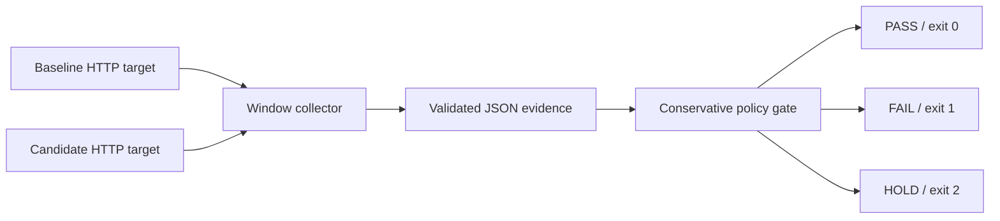

# Release Guard

[](https://github.com/nazek52/release-guard/actions/workflows/ci.yml)

An explainable, fail-closed canary gate. Compare a candidate to a baseline over consecutive windows and return **PASS**, **FAIL**, or **HOLD** with machine-readable evidence. A missing metric must never silently approve a release.

**Python · statistics · CI/CD · Docker · operational failure testing**

[Русский разбор и подготовка к интервью](docs/INTERVIEW.ru.md) · [Design decisions](docs/architecture.md) · [Runbook](docs/runbook.md) · [Verification](docs/verification.md)

## What makes it useful

- Error rates use Wilson intervals instead of treating zero observed errors as zero risk.
- Histogram p95 is an interval, not an invented precise value. Coarse or unbounded buckets can produce HOLD.
- Reject stale/future timestamps, overlapping or gapped windows, invalid counters, low traffic, and malformed histograms.
- Require both absolute budgets and baseline-relative budgets in every window.
- Exit codes: **0 PASS**, **1 FAIL**, **2 HOLD/invalid**. Only 0 may feed a promotion step.
- The tool evaluates evidence; it does not mutate a cluster or roll back a deployment.



## Run in two minutes

Python 3.13+. Runtime has no external Python dependencies.

```sh
python -m guard examples/healthy.json --now 2026-01-01T00:05:00Z
python scripts/verify_fixtures.py
python -m pip install -r requirements-dev.txt
python -m pytest -q
```

`--now` is for deterministic replay only. Omit it on live metrics. `examples/` contains explicitly synthetic fixtures for PASS, FAIL, low volume, and stale evidence.

## Real HTTP demonstration

Docker with Compose v2 and Linux containers is required. Ports bind to loopback. The demo uses a deliberately simple local service, not production traffic.

```sh
docker compose up -d --build --wait
python demo/collect.py
python -m guard artifacts/evidence.json --output artifacts/healthy-report.json
```

Change the candidate to a slow service that fails every fifth request:

```sh
# Bash
CANARY_MODE=degraded docker compose up -d --wait canary
# PowerShell alternative
$env:CANARY_MODE='degraded'; docker compose up -d --wait canary
```

Then run:

```sh
python demo/collect.py --output artifacts/degraded.json
python -m guard artifacts/degraded.json --output artifacts/degraded-report.json
# Expected exit code: 1. Healthy CPU scheduling can vary; inspect evidence on HOLD.
docker compose down
```

The demo network defaults to `10.203.42.0/24`; set `LAB_SUBNET` to an unused subnet if it overlaps your environment. Existing networks are never pruned.

## Policy and evidence

Use `--policy policy.json` for overrides. Unknown keys are rejected. Defaults: 300 requests per arm per window, two consecutive windows, max 2% error rate, max +2 percentage-point error regression, 150ms p95, and max 3x p95 regression. These are **demo policy choices**, not universal SLOs. See `guard/policy.py` and `examples/healthy.json` for the complete schema. Histogram counts are cumulative; the final `+Inf` bucket must equal requests. `null` in a reported upper interval means unbounded.

The two 95% Wilson intervals and their combined extrema are conservative comparisons, **not** a formal sequential hypothesis test or a guaranteed family-wise 95% confidence claim. Traffic must be comparable between arms. Repeated looks, correlated failures, traffic imbalance, and selection bias require a more sophisticated rollout design.

## CI

GitHub Actions runs the unit tests, replays fixtures, builds isolated targets, collects healthy HTTP traffic, injects degradation, requires rejection, and uploads evidence. It removes only its own demo containers. It never deploys to an external environment.

Personal, AI-assisted engineering project; no production employment or customer outcomes are claimed. [MIT](LICENSE).
